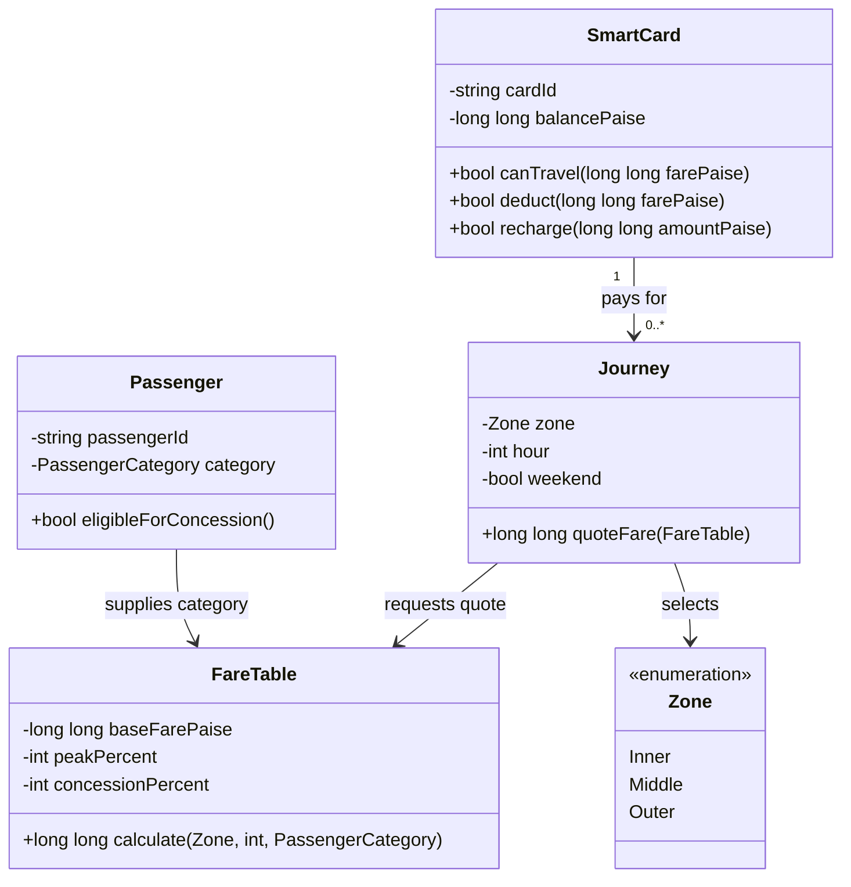

# Task 1 — Understand the problem and identify the objects

## Object-oriented model

- **SmartCard** has a card ID and a private balance stored as integer paise. Its operations are `canTravel(fare)`, `deduct(fare)`, and `recharge(amount)`. It owns the balance rule so callers cannot directly make the balance negative or leave less than Rs 50 after a paid journey.
- **Passenger** has an ID and a category such as regular, student, or senior citizen. It reports which concession policy applies. The assignment does not state the concession percentage, so the rate must be a named policy value agreed with the faculty; the worked draft assumes 50% only as an explicit example.
- **Journey** records the selected zone and departure time (and, when needed, date/weekend status). It asks the fare policy to quote the journey and asks the card to authorize payment.
- **Zone** is a closed set of values: Inner, Middle, and Outer in the first version. `enum class Zone` prevents an unrelated integer from being used as a zone by accident.
- **FareTable** owns the base fares, peak windows, surcharge, concession rule, and fare calculation. Keeping the policy in one place avoids inconsistent fare copies.

## Journey rules and assumptions

Money is represented in paise. The peak intervals are start-inclusive and end-exclusive: 08:00–09:59 and 17:00–19:59. Therefore 10:00 and 20:00 are off-peak. A journey is rejected for an invalid zone/time, a negative fare, or a payment that would leave less than 5000 paise. A rejected journey does not change the card. A successful paid journey deducts exactly one non-negative fare. The scenario omits the concession rate and its ordering relative to the peak surcharge; both must be confirmed before production use. For examples in this draft only, assume a 50% concession applied after the peak surcharge.

## OOP and procedural comparison

Encapsulation keeps the card balance private and enforces its invariant through methods. Abstraction exposes operations such as “quote fare” and “pay” without exposing the calculation details. Inheritance could model `StudentPassenger` and `SeniorPassenger`, but it is unnecessary for two simple categories; a category plus a concession policy is easier to extend. Polymorphism could be used for interchangeable `FarePolicy` implementations, such as standard and concession policies, if policies later become more complex.

A procedural version could store balances, categories, and journey data in structs or arrays, then pass them to free functions such as `calculateFare(...)` and `deduct(...)`. The same per-journey operations and per-card storage remain **O(1)** in both designs. A centralized fare function/table means one policy change touches one location; a scattered procedural design risks updates in several call sites. OOP makes the balance invariant harder to bypass, while procedural code can still be correct if every caller follows the same checks.

## UML sketch

**Complexity:** fare lookup and card authorization take O(1) time per journey; a card stores O(1) state. Processing `n` journeys takes O(n) total time.
