# Assignment 2 [CO2] - Report

**Student:** Hitesh  
**Register number:** 192524005  
**Subject:** DSA0101 - C++  
**Assignment:** Functions and Object-Oriented Concepts

This report contains the answers, analysis, source and output evidence for Tasks 1-7.

## Compiler and documentation

Compiler: LLVM-MinGW g++ driver, Clang 23.1.1, target `x86_64-w64-windows-gnu`; C++17. Normal flags: `-Wall -Wextra -Wconversion -pedantic -O2`. Exact build and run commands are in the repository `README.md`.

Q2 contains a deliberately unsafe local-reference function to demonstrate the compiler warning; it is not called. Captured output images show saved run records opened in Notepad. Source captures show views of the source files; the complete `.cpp` files are in each task folder. These captures are from the Codex workspace, not proof of Hitesh's individual lab execution. The assignment requires independent pre-run predictions and individual execution, so Hitesh should make the predictions, rerun the tasks, and capture lab evidence if required.

This work is stored in the existing selected repository. The PDF asks for a separately named repository; confirm with the instructor that the selected repository is acceptable.

## Task 1

# Q1 - Call by value, reference and pointer

## Prediction for the supplied program

Before running the supplied code, the expected lines are:

```text
1 12 13
1 100
16 13 6
```

`a` is copied into parameter `a`, so its caller value remains 1. `b` is an alias for the caller's `b` and becomes 12. `c` is reached through the pointer and becomes 13. `bigger(a, c)` returns a reference to the larger object, `c`, so assigning 100 changes `c`. The defaults for `show(1)` are `y=5` and `z=10`; `show(1, 2)` uses only `z=10`; the final call supplies all three values.

## Fee update methods

The program runs the three parameter styles on separate copies of a 45,000 fee:

| Style | Example | Stored fee after call | Reason |
|---|---|---:|---|
| Value | `applyByValue(fee, 10)` | 45,000 | The parameter is a local copy. |
| Reference | `applyConcession(fee, 15)` | 38,250 | The reference names the caller's object. |
| Pointer | `applyByPointer(&fee, 25)` | 33,750 | Dereferencing the pointer writes to the caller's object. |

The completed TODO applies 10% by reference. Integer arithmetic computes `fee * percent / 100`; on 45,000 the result is 4,500, leaving 40,500. The actual run is recorded in `RUN_OUTPUT.txt`.

## Interface decision and complexity

For a function whose stated job is to update an existing student record, a non-const reference makes the mutation visible in the parameter list and avoids copying the record. A pointer is useful when “no object” is a valid input, but then it must be checked for null. For combining several concessions, returning a new fee is also a good interface: calculate each step and assign the final value explicitly. The returned-value version and the in-place version both take O(1) time for a fixed number of percentage operations.

On this compiler target, `sizeof(long long)` is 8 bytes. Passing it by value copies those 8 bytes; passing by reference or `const` reference copies no fee object and uses an implementation-sized reference. Passing a large `Student` by value copies all of its fields and padding, so its copy cost grows with the object size. Passing it by `const Student&` avoids that copy while preventing changes through that parameter. The reference and pointer versions still require the caller's object to remain alive for the call.

## Reference implementation

`q1_call_modes.cpp` includes the supplied output-prediction program and the completed concession examples. The output file is an actual run transcript from this workspace; make your own prediction before running it independently for the assignment requirement.

**Source capture:**  
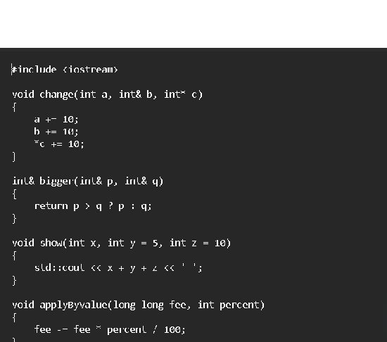

**Output capture:**  
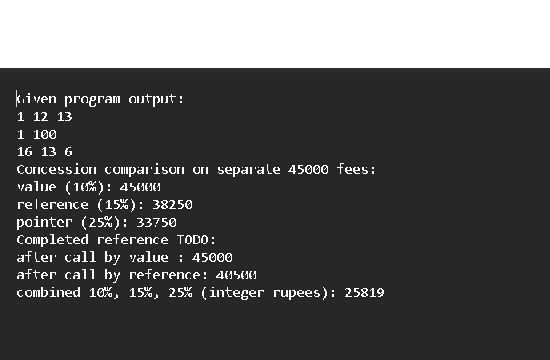

## Task 2

# Q2 - Return by reference and its dangers

## What the program demonstrates

`highestMark` scans the array and returns a reference to its largest element. The caller can read it or write through it: `int& top = highestMark(...); top += 2;`. This changes the array element from 91 to 93. A `const int&` can read the value without copying it but cannot change it through that name. A returned `int` copy is independent; changing the copy does not update the array.

The run also shows the index and pointer alternatives. The index is used as `marks[index]`; the pointer is used as `*pointer`. Each search is O(n) time and O(1) extra space. Returning an index is often the clearest choice if the caller needs to refer back to the array later. A pointer has the same lifetime requirement as a reference.

## Dangling reference warning

`danglingReference()` is included solely to trigger the compiler diagnostic and is never called. It returns `localMark`, whose lifetime ends when the function returns. The compiler reports `reference to stack memory associated with local variable 'localMark' returned`. Using the returned reference would be undefined behaviour; it is not made safe by the fact that the old bytes sometimes appear to remain in memory.

## Vector growth condition

When `std::vector` grows beyond its capacity, it may allocate a new block and move its elements. References, pointers, and iterators to the old elements then become invalid. Code must not retain a reference across a possible reallocation. An index can be used again after growth if the logical element order and index are still valid. A pointer or reference into a vector is not safer than one into an array in this situation.

## Complexity

Finding the highest of n marks takes O(n) time in the reference, pointer, and index versions, with O(1) extra space. The returned reference avoids copying the selected mark. A copy uses O(1) space for one `int` but cannot update the original. The vector example prints its capacity before appending; whether the append reallocates depends on the reported capacity. In this run the capacity was 3 and the append increased the size to 4, so the old storage had to be replaced.

## Evidence note

The warning is preserved in `compiler_warning.txt`; the safe demonstration output is in `RUN_OUTPUT.txt`. Never run the dangling-reference function to try to obtain an output value.

**Source capture:**  
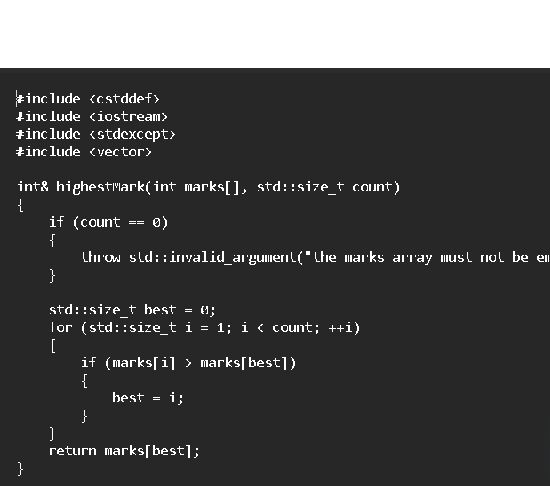

**Output capture:**  
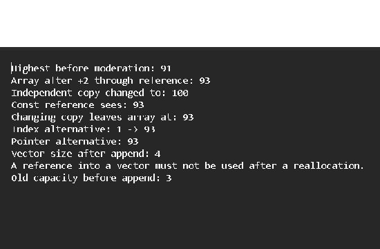

## Task 3

# Q3 - Default arguments and function overloading

## Why the original set is ambiguous

With `charge(double)`, `charge(double, bool)`, and `charge(double, bool = false, bool = false)`, a one-argument call such as `charge(2.0)` can match the first function and the third function (using its default values). Neither candidate is a better match, so the compiler reports an ambiguous call. Default arguments do not create a distinct function signature.

## Redesigned interface and six calls

`q3_courier_overloads.cpp` uses one `int` overload for grams, one `double` overload for kilograms, and one `Parcel` overload. Optional flags are defaulted only on the numeric overloads. A `Parcel` is passed by `const` reference to avoid copying it. The six calls in the program select:

| Call | Selected function | Reason |
|---|---|---|
| `charge(2)` | `charge(int, bool, bool)` | Exact match for an integer literal. |
| `charge(2.0f)` | `charge(double, bool, bool)` | `float` to `double` is a promotion; conversion to `int` is worse. |
| `charge(2.0)` | `charge(double, bool, bool)` | Exact match for a double literal. |
| `charge(750, true)` | integer grams overload | Exact match for the first argument; the last option uses its default. |
| `charge(parcel)` | `charge(const Parcel&)` | Exact match for the object type. |
| `charge(2.5, false, true)` | kilogram overload | Exact match for the double first argument. |

The output labels the selected overload and displays its computed charge. The predictions above are reference reasoning; write your own predictions before running the program independently.

## Overload rules and alternatives

The compiler considers viable overloads and prefers an exact match over a promotion, and a promotion over a standard conversion. If two viable candidates have equally good conversions, the call is ambiguous. Default arguments must be supplied from the right because a call may omit only trailing arguments; a required argument cannot follow an omitted one.

Overload resolution happens at compile time and adds no run-time dispatch cost. A single `Parcel` structure with optional fields would make adding options explicit in one object and avoid overload growth, but makes even simple calls longer. A function template could generalize input types, but needs constraints and still requires clear rules for units. Passing a parcel by `const` reference avoids copying its fields; passing by value copies them. The numeric arguments are small scalars. Each charge calculation takes O(1) time.

**Source capture:**  
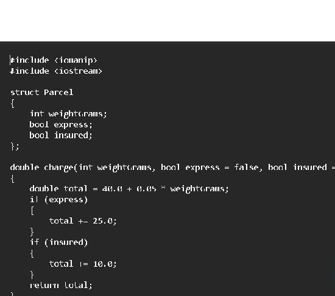

**Output capture:**  
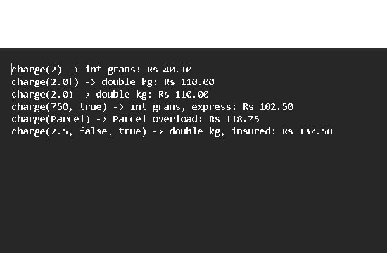

## Task 4

# Q4 - Savings account class with a transaction array

## Class design

`SavingsAccount` keeps its account number, balance, ten-entry transaction array, start index, and count private. Public functions provide deposits, withdrawals, and a mini-statement. The small `deposit()` and `balance()` functions are defined inside the class; `record()`, `withdraw()`, and `miniStatement()` are defined outside with `SavingsAccount::` scope resolution.

Keeping the array private protects the count and ring positions from being changed inconsistently. The program records twelve valid transactions and prints the most recent ten (transactions 3 through 12). Its final balance is 1,560. A rejected deposit or withdrawal does not change the balance or history.

## How old transactions are discarded

The chosen implementation is a circular fixed array. While fewer than ten entries exist, a new record is placed after the latest record. Once full, the new record replaces the oldest and the start index advances. Adding a transaction is O(1) time and the storage is O(10), fixed per object. The eleventh transaction replaces transaction 1 without shifting the other nine.

Shifting a full fixed array left before every insertion costs O(k) for k stored entries; it is easy to understand but makes each insertion slower as the history grows. A `std::deque` can use `push_back` and `pop_front`, with O(1) time at the ends on average and dynamically managed storage. For a strict limit of 50, changing the fixed capacity from 10 to 50 is the smallest code change, at the cost of a larger fixed array in every account. A circular buffer still gives O(1) insertions at either capacity.

## Evidence

The full source is `q4_savings_account.cpp`; the recorded run output is `RUN_OUTPUT.txt`. No user input is needed because the test transactions are listed directly in `main()`.

**Source capture:**  
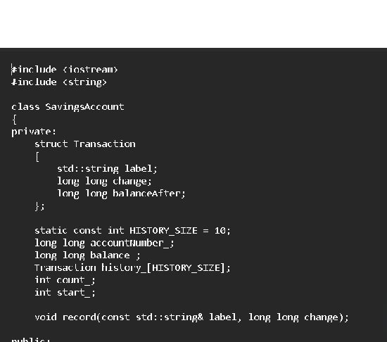

**Output capture:**  
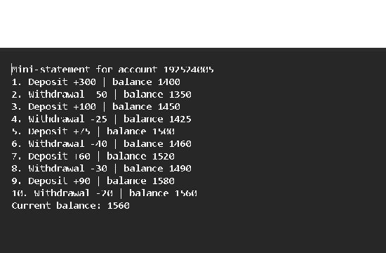

## Task 5

# Q5 - Static members and arrays of objects

## Token prediction and result

`Token::next` starts at 100. Constructing `counter[3]` runs the constructor three times and gives IDs 101, 102, and 103. Constructing `extra` runs it a fourth time and gives ID 104. Therefore the supplied expression prints:

```text
101 103 104 4
```

The static `issued` counter belongs to the class, so all `BusTicket` objects share it. It is defined once outside the class as `int BusTicket::issued = 0;`. The static `count()` function can be called as `BusTicket::count()` and does not need a ticket object. A static function has no `this` pointer and cannot directly access a non-static member such as one ticket's `seat` or `name`.

## Capacity test

The TODO logic increments `issued` and gives the ticket that seat only while `issued < CAPACITY`. The four-object array therefore assigns seats 1, 2, and 3; the fourth ticket is placed on the waiting list; the count remains 3. The program also calls a ticket-creation function twice after capacity is reached. Both later tickets wait, and the shared count remains 3.

Objects in an array are constructed in element order. Objects created in a loop or in another function still use the same static counter; leaving the function does not reset the static member. This design assumes one bus. If two buses operate at once, one static counter would mix their capacity. A `TicketOffice` object per bus, passed by reference to each ticket, would keep the counts independent. A global counter has O(1) time and storage too, but exposes state outside the class and is harder to manage for two offices. The static counter is encapsulated but still shared across all buses of this class.

The source is `q5_static_bus_tickets.cpp`; the run transcript is `RUN_OUTPUT.txt`.

**Source capture:**  
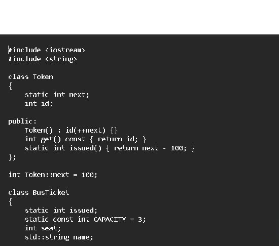

**Output capture:**  
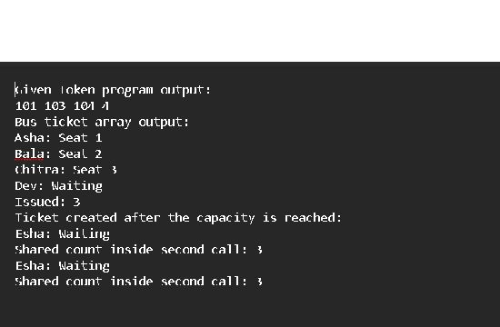

## Task 6

# Q6 - Friend functions and inline functions

## Why the comparison is a friend

`minutesBetween(a, b)` and `earlier(a, b)` treat the two `Time` values symmetrically. They are non-member functions, so their calls read naturally with both times as arguments. Friendship lets them read private `h` and `m` without making those fields public. A member version such as `a.minutesTo(b)` could also access private data and may be a better fit if the operation is considered behaviour of one `Time` object. Public getters keep the class encapsulated but add accessors. Friendship should be limited to functions that need direct access.

Making `h` and `m` public would let every caller create invalid values such as hour 30 or minute 90, so it weakens the class invariant. A robust larger class could validate inputs in its constructor.

## Correctness

The functions convert each time to minutes after midnight and compare/subtract those values. The supplied test prints `205 false`. A test spanning noon (`11:55` and `12:10`) prints a 15-minute difference and says the first time is earlier. Comparing `14:05` with another `14:05` prints difference 0 and `false` for earlier.

## Inline measurement

In C++, `inline` permits equivalent definitions in multiple translation units and suggests that a call may be expanded at the call site; it does not require the compiler to do so. The compiler may inline a function without the keyword. Each build below ran 10,000,000 calls with a fixed set of 1,024 generated time pairs; the checksum was identical. The four measurements are from this machine, using the `g++` driver for LLVM-MinGW/Clang 23.1.1, C++17. Timings vary with system load.

| Build | Median of 5 runs (microseconds) |
|---|---:|
| No `inline`, `-O0` | 164,112 |
| `inline`, `-O0` | 125,588 |
| No `inline`, `-O2` | 17,484 |
| `inline`, `-O2` | 11,420 |

In these five-run medians, the inline-labelled build is faster in both settings, but the `-O2` improvement is much larger and system load can change close comparisons. The keyword is still not a guarantee that a call is expanded; the compiler decides. The function work is O(1) per call and uses O(1) extra space. The five runs per variant are saved in the `q6_*_runs.txt` files; the exact compile commands are in the top-level README.

**Source capture:**  
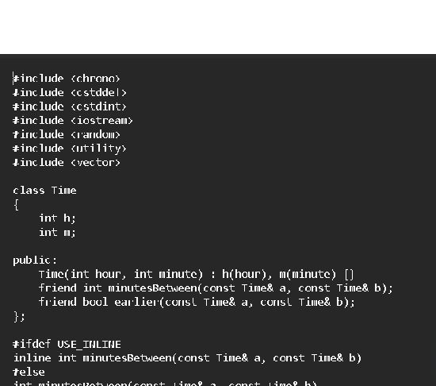

**Output capture:**  
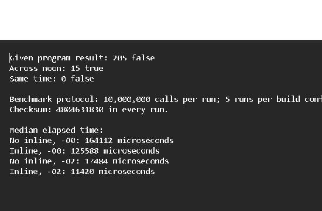

## Task 7

# Q7 - Diagnose, redesign and validate

## A. Limitation in Q2

Q2 finds the largest mark by scanning the entire register. One lookup costs O(n). If the result is requested repeatedly while marks stay unchanged, the same n values are compared again and again. For n=10,000 and 1,000 queries, this performs about 10,000,000 comparisons.

## B. Measurable objective

Keep the highest-mark result correct while making repeated read-only highest-mark queries O(1), and compare both designs using the same 10,000-mark data and 1,000 queries. The redesigned class must also remain correct when a mark changes.

## C. Revised design

`CachedMarkRegister` owns a copy of the marks and stores the index of the current maximum. Construction scans once (O(n)). A query returns the stored index in O(1). Updating a non-maximum mark is O(1); raising a mark above the maximum is O(1); lowering the current maximum requires a rescan in O(n). The design uses O(1) extra index storage in addition to the mark array. It deliberately does not substitute a library algorithm for the design decision.

```text
CachedMarkRegister
  - marks: vector<int>
  - highestIndex: size_t
  + highestIndex(): size_t
  + update(index, newMark): void
  - refreshHighest(): void
```

The old reference-based result can still be useful for one lookup and immediate moderation. The cached index is preferable when there are many read-only queries between updates. A returned index survives vector reallocation as a number, though its meaning must be checked if elements are inserted, removed, or reordered.

## D. Prediction before the comparison run

With 10,000 marks and 1,000 repeated queries, I expect the scan version to examine about 10 million mark values. The cached version should perform one O(n) initialization and then 1,000 O(1) lookups. Both versions should report the same maximum index and checksum.

## E. Implementation and validation

`q7_cached_highest.cpp` runs the same deterministic input against the scan and cache designs. It lowers the current maximum in a small correctness test and confirms that the cached index is recomputed. For the timed workload, both data sets update the same non-maximum entry before each query, so the scan call cannot be moved out of the loop by optimization. Both checksums are compared. This run took 6,496 microseconds for the scan and 2 microseconds for the cached queries; both indices were 5,000 and both checksums were 5,000,000. These timings exclude cache construction and should be treated as measurements of this particular run, not as universal results.

## F. Evaluation

The objective is met when both checksums and the final indices match and the measured repeated-query time is lower for the cache. The cache costs one extra index and makes updates to the current maximum slower because it rescans. If marks change often or only one query is needed, the original scan is simpler and may be preferable. Timing measurements exclude construction and are affected by system load; construction still costs O(n), so the gain depends on repeated queries between changes.

**Source capture:**  
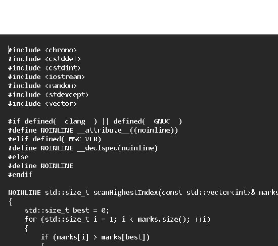

**Output capture:**  
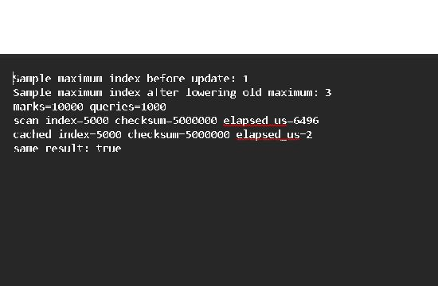

