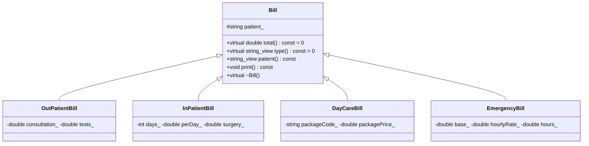

# Task A1 — Polymorphic Bill Hierarchy

## Common interface

Every bill has a non-empty patient record and provides `total()`, `type()` and `print()`. `total()` and `type()` are pure virtual; `print()` is a common non-virtual function that calls those virtual operations. The base destructor is virtual so deleting a derived bill through a `Bill*` destroys the complete object.

## UML



## SIMATS-style pseudocode

**Algorithm 1: DAILY_BILL_TOTAL**  
**Input:** `bills`, a collection of references to `Bill` objects  
**Output:** total amount for all bills

```text
BEGIN DAILY_BILL_TOTAL(bills)
    SET dailyTotal <- 0
    FOR EACH bill IN bills
        SET dailyTotal <- dailyTotal + bill.total()
    END FOR
    RETURN dailyTotal
END
```

The call is dispatched to the implementation belonging to the object's dynamic type. With `n` bills, time is `O(n)` and the extra accumulator space is `O(1)`; storage for the bill objects is `O(n)`.

## Alternative: one record and a switch

A single `BillRecord` could contain a type tag and the fields for every possible bill. `total(record)` would switch on the tag and apply the corresponding formula. This is also `O(n)` for a daily total, but each record reserves the fields needed by its largest case. Adding a type changes the tag, switch, record, tests and all callers that assume the old cases. The abstract interface gives each derived type only its own fields and keeps processing code independent from the list of bill types.
